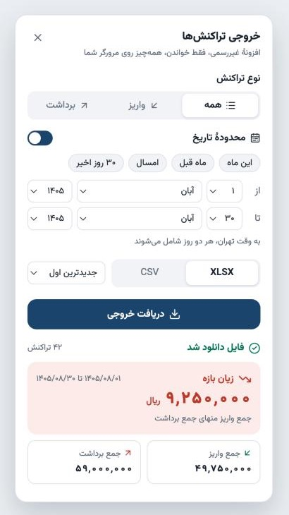

<div dir="rtl">

# خروجی تراکنش‌های مفید (غیررسمی)

افزونهٔ کروم برای گرفتن خروجی CSV یا XLSX از صفحهٔ «گردش حساب» در `my.emofid.com`.



## امکانات

- خروجی کل تاریخچه یا یک بازهٔ تاریخ شمسی
- فیلتر همه، فقط واریز یا فقط برداشت
- قالب CSV یا XLSX
- نمایش سود و زیان بازه (جمع واریز منهای جمع برداشت)

## حریم خصوصی

- فقط خواندن؛ هیچ تراکنش یا تغییری انجام نمی‌شود.
- همه‌چیز روی مرورگر شما می‌ماند. هیچ داده‌ای به جایی جز خود سایت مفید فرستاده نمی‌شود.
- این افزونه غیررسمی است و وابستگی‌ای به کارگزاری مفید ندارد.

## نصب

1. وابستگی‌ها را نصب و افزونه را بسازید:

   ```bash
   pnpm install
   pnpm build
   ```

2. صفحهٔ `chrome://extensions` را باز کنید و «Developer mode» را روشن کنید.
3. روی «Load unpacked» بزنید و پوشهٔ `.output/chrome-mv3` را انتخاب کنید.
4. وارد حساب مفید (Emofid) شوید و به صفحهٔ «گردش حساب» بروید. دکمهٔ «خروجی تراکنش‌ها» پایین سمت چپ صفحه است.

## توسعه

پیش‌نیاز: Node.js نسخهٔ ۲۰ به بالا و pnpm.

| دستور | کار |
| --- | --- |
| `pnpm dev` | اجرای افزونه با بارگذاری خودکار |
| `pnpm demo` | نمایش پنل با دادهٔ ساختگی، بدون نیاز به ورود (`localhost:5199`) |
| `pnpm test` | اجرای تست‌ها |
| `pnpm typecheck` | بررسی تایپ‌ها |
| `pnpm build` | ساخت نسخهٔ نهایی در `.output/chrome-mv3` |
| `pnpm zip` | ساخت فایل zip برای Chrome Web Store |

ساختار پروژه:

- `entrypoints/` اسکریپت‌های افزونه (پل ارتباط با صفحه و پنل)
- `src/data/` دریافت صفحه‌به‌صفحهٔ تراکنش‌ها
- `src/domain/` نرمال‌سازی، تشخیص واریز و برداشت، فیلترها
- `src/dates/` تاریخ شمسی و وقت تهران
- `src/export/` ساخت CSV و XLSX
- `src/ui/` پنل (Vue)
- `demo/` صفحهٔ آزمایشی با دادهٔ ساختگی
- `docs/api-notes.md` یادداشت‌های API سایت

</div>
